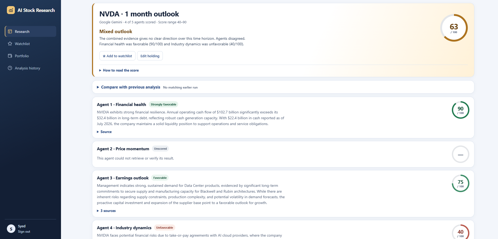
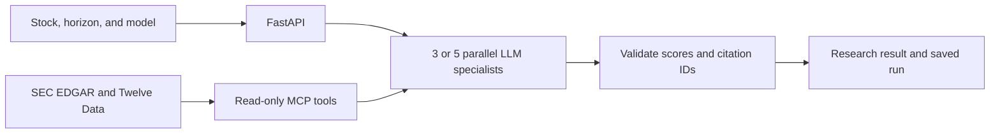
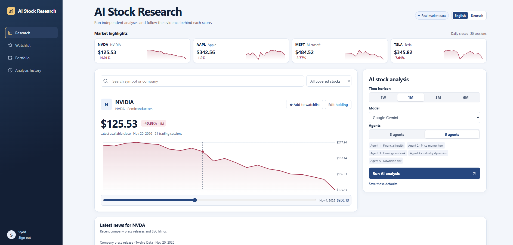

# AI Stock Research

An **AI-powered, multi-agent stock research application** built with Python, FastAPI, and React. It runs three or five specialist analyses concurrently, retrieves role-specific evidence from SEC filings and market data through the Model Context Protocol (MCP), and shows how each specialist's citations and score contribute to the overall outlook.

[Run the demo](#run-with-docker) · [Explore the AI pipeline](#ai-research-pipeline) · [Browse the code](#code-map)

*Example Gemini run. Four of five specialists returned usable scores.*

## Run with Docker

Start Docker Desktop with Linux containers, then run this from the project folder.

~~~sh
docker compose up --build
~~~

1. Open [http://127.0.0.1:8082](http://127.0.0.1:8082) and choose **Open demo**. The demo uses synthetic market data and rule-based scores and runs without API keys or an `.env` file.
2. Select **AAPL**, **1M**, and **3 agents**. Run the demo analysis and expand each agent's sources. The bundled example returns **69/100**, with **79** for financial health, **46** for price momentum, and **83** for earnings outlook.
3. Run it again with the same settings, then open **Compare with previous analysis** to review the overall score, individual specialists, and changes in the cited evidence.

If port 8082 is in use, set `DASHBOARD_PORT=8083` in `.env` and open [http://127.0.0.1:8083](http://127.0.0.1:8083). Run `docker compose down` to stop the app. The named volume keeps the local workspace.

## AI research pipeline

1. **Retrieve evidence.** The Python backend launches a separate MCP subprocess over stdio. Read-only tools fetch company financials and daily closes, or use lexical search to rank passages from recent SEC filings against the specialist's query. Evidence carries source IDs and dates, with links where available.
2. **Run the specialists in parallel.** Python's `asyncio.gather` runs each role independently. Each specialist gets its own task and evidence and calls the selected Gemini, OpenAI, or Claude model. The prompt requests an English and a German explanation in the same call and instructs the model to treat source passages as data.
3. **Validate and score.** The backend checks the structured response for a 0–100 integer score or an unscored result, a usable explanation, and valid citation IDs. A scored response must cite at least one item from that specialist's evidence. Failed or unsupported results stay unscored. The dashboard shows the rounded average of the usable scores, the score range, and how many agents contributed.
4. **Compare saved runs.** The React dashboard finds the most recent earlier run with the same stock, horizon, provider, model, data mode, scoring version, and specialist roles. It highlights overall and per-agent score changes, newly cited sources, and updated data snapshots using the saved results.

| Specialist | Evidence | Available in |
| --- | --- | --- |
| Financial health | SEC company facts covering cash, debt, operating cash flow, and revenue | 3- and 5-agent runs |
| Price momentum | Daily closing prices and the return over the selected window | 3- and 5-agent runs |
| Earnings outlook | SEC filing excerpts on guidance, demand, and revenue | 3- and 5-agent runs |
| Industry dynamics | SEC filing excerpts on competition, capacity, and pricing | 5-agent runs |
| Downside risk | SEC filing excerpts on concentration, refinancing, and other risks | 5-agent runs |

Scores summarize how the available evidence leans over the selected horizon. Use the cited sources to check the explanations and make your own assessment. The project is for research and education.

*Research setup with Google Gemini and five specialists selected.*

## Code map

| Area | Implementation |
| --- | --- |
| Multi-agent orchestration | [Python specialist roles, model adapters, JSON validation, and aggregation](backend/stock_research/analysis.py) |
| Evidence retrieval | [MCP client](backend/stock_research/mcp_client.py), [read-only MCP tools](backend/stock_research/mcp_server.py), and [SEC/Twelve Data retrieval and passage ranking](backend/stock_research/market.py) |
| API and persistence | [FastAPI routes](backend/stock_research/app.py), [Supabase or SQLite storage](backend/stock_research/storage.py), and [owner-scoped Supabase tables](supabase/migrations/202611200001_workspace.sql) |
| Research interface | [React, Vite, and Tailwind frontend](frontend), [agent results and evidence](frontend/src/AnalysisResult.jsx), and [saved-run comparison](frontend/src/analysis-comparison.js) |

The workspace also includes an interactive price chart, company headlines and filings, a manual portfolio that estimates value and unrealized gain or loss in USD, and a watchlist that highlights recent filings and daily closing-price moves of at least 3%. Use **English** or **Deutsch** to switch the interface and read available bilingual explanations. The current catalog covers 12 US stocks.

## Enable market data and model APIs

Copy [`.env.example`](.env.example) to `.env` to configure live research. Set `MARKET_DATA_MODE=live`, `TWELVE_DATA_API_KEY`, and `SEC_USER_AGENT` with your app name and contact email for SEC EDGAR. Configure at least one model provider.

| Provider | API key variable | Model variable |
| --- | --- | --- |
| Google Gemini | `GEMINI_API_KEY` | `GEMINI_MODEL` |
| OpenAI | `OPENAI_API_KEY` | `OPENAI_MODEL` |
| Anthropic Claude | `ANTHROPIC_API_KEY` | `ANTHROPIC_MODEL` |

Apply environment edits with `docker compose up -d`. Keep credentials in the server environment. Model inputs are limited to the ticker, horizon, and public research evidence with its metadata. Portfolio holdings and account details stay in the workspace.

## Run without Docker

Install Node.js 24 and Python 3.13, then run these commands from the project folder in PowerShell.

~~~powershell
npm --prefix frontend ci
npm --prefix frontend run build
python -m venv .venv
.\.venv\Scripts\python.exe -m pip install -r backend/requirements.txt
Set-Location backend
..\.venv\Scripts\python.exe -m stock_research
~~~

Open [http://127.0.0.1:8082](http://127.0.0.1:8082) and choose **Open demo**. The demo needs no external accounts or API keys. FastAPI generates an [OpenAPI specification](http://127.0.0.1:8082/openapi.json) in local mode. To work on React with hot reload, keep Python running on port 8082 and run `npm --prefix frontend run dev` from the project root in a second terminal. Vite proxies API calls to the local Python server.

## Connect a dedicated Supabase project

1. In the new project, run [the workspace migration](supabase/migrations/202611200001_workspace.sql) in the SQL Editor.
2. Use [.env.example](.env.example) to add `SUPABASE_URL` and `SUPABASE_PUBLISHABLE_KEY` to `.env`. Set them to the project URL and its publishable key.
3. In Auth URL Configuration, set the Site URL to the dashboard address. The app also requests this address when sending confirmation links. Use `http://127.0.0.1:8083` if your Compose port is 8083. Enable email and keep **Confirm email** on in the email provider settings.
4. Restart the app. Choose **Create account** and enter a username, email, and password. Open the confirmation link and then sign in with your email and password.

Supabase's default email delivery is for testing with project team members. To send confirmation emails to other addresses, connect a [custom SMTP sender](https://supabase.com/docs/guides/auth/auth-smtp). For numeric codes, include `{{ .Token }}` in the **Confirm signup** [email template](https://supabase.com/docs/guides/auth/auth-email-templates) and set `SUPABASE_EMAIL_CONFIRMATION=code`. New free projects need custom SMTP to edit this template.

Supabase Auth manages credentials. The app stores a hashed session identifier in SQLite. In hosted mode, Supabase stores watchlists, holdings, preferences and run history and enforces ownership with PostgreSQL row-level security. The dashboard encrypts server-side access and refresh tokens when `SESSION_ENCRYPTION_KEY` is configured. Public mode requires that key.

## Deploy behind HTTPS

1. Choose the public HTTPS URL and a host that can run one Python container with a persistent volume. The production Compose file publishes the app on the host's loopback interface. Point an HTTPS reverse proxy at that loopback port, preserve the public `Host` header, and redirect HTTP traffic to HTTPS at the proxy.
2. Copy `.env.example` to `.env.production` on the host. Set `PUBLIC_ORIGIN` to the exact HTTPS origin without a trailing slash and use the Supabase publishable key. Generate a deployment-specific `SESSION_ENCRYPTION_KEY` and keep it in the host's secrets so it stays available across restarts.

   ~~~sh
   python -c "import secrets; print(secrets.token_urlsafe(32))"
   ~~~

3. In Supabase, set the Site URL and allowed redirect URLs to the exact production address. Keep email confirmation enabled and connect a verified [SMTP sender](https://supabase.com/docs/guides/auth/auth-smtp). Set the **Reset password** email template to send the numeric code with `{{ .Token }}`, then set `SUPABASE_PASSWORD_RECOVERY=code` in the production environment to enable the in-app form. Use the same approach for **Confirm signup** and set `SUPABASE_EMAIL_CONFIRMATION=code` if using confirmation codes. Set Supabase's password minimum to match the app's 12-character minimum for new passwords and review the project's available [password protections](https://supabase.com/docs/guides/auth/password-security).
4. Run the production Compose file and verify the app through its HTTPS URL. Test signup with an email outside the Supabase team, password recovery, and sign-out with a second tab open. Add rate limiting at the HTTPS proxy if running public registration. Confirm your [Twelve Data terms](https://support.twelvedata.com/en/articles/5332349-commercial-and-personal-usage) cover the data you plan to display, including company press releases.

   ~~~sh
   docker compose --env-file .env.production -f compose.production.yaml up --build -d --wait
   ~~~

The production deployment uses a separate volume from the local demo. The public session cookie uses `Secure`, `HttpOnly`, and a host-only prefix. Sign-out removes the app session before contacting Supabase to revoke it. An app password reset also invalidates the account's existing dashboard sessions.

## Verify

After [setting up the local runtimes](#run-without-docker), run the frontend checks and Python tests from the project folder.

~~~powershell
npm --prefix frontend test
npm --prefix frontend run build
Push-Location backend
..\.venv\Scripts\python.exe -m unittest discover -s tests -v
Pop-Location
~~~

The integration suite runs the real MCP subprocess against synthetic market data. It also tests filing retrieval, bilingual model responses, partial data outages, account isolation, and session security using controlled fixtures. Frontend tests cover matching past analyses and reporting API errors.
